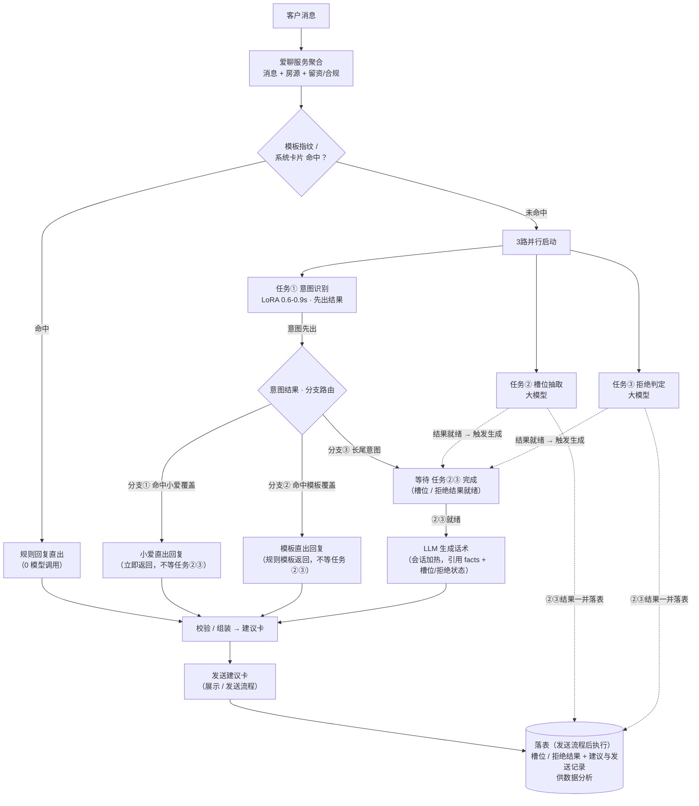

# 新旧小爱融合方案

## 一、背景

现有意图识别为 **3 路并行大模型调用**（任务①意图识别 / 任务②需求槽位抽取 / 任务③拒绝留资判定），汇总后再执行话术生成，端到端约 **5-6s**，时效不达标。

为降低时延，引入两个既有能力做前置路由：

- **LoRA 意图模型**：0.6-0.9s，只覆盖高频意图子集，仅输出意图分类，充当任务①（意图识别）并**先出结果**；
- **小爱助手**：轻量语义话术生成，覆盖约 25% 语义点，纯话术输出（状态由系统侧维护）。

**方案思路**：以 LoRA 做意图识别并先出结果，据此路由 → 小爱可覆盖的走**小爱直出**（快路径 ≤1s）、模板可覆盖的走**模板直出**、长尾意图仍走 **LLM 生成**；任务②③（槽位 / 拒绝）并行或后台执行，结束后落表供数据分析。

---

## 二、架构图

---

## 三、各输出路线耗时

> 已确认值：LoRA **0.6-0.9s**；现状端到端 **5-6s**；快路径目标 ≤1s。
> 【待确认】= 需实测/向算法确认；括号为当前预估假设（用于估算，不代表最终值）。
> 发送建议卡、落表为流程后置/异步，**不计入**建议卡生成时延。

| 输出路线\节点耗时 | 模板指纹匹配 | ① 意图识别 | ② 槽位抽取 | ③ 拒绝判定 | ④ 回复生成 | ⑤ 校验/组装 | 总耗时预期 |
|---|---|---|---|---|---|---|---|
| **0. 模板指纹直出** | ~50ms | — | — | — | 规则直出 ~50ms | ~0ms | **≈0.1s** |
| **1. 小爱直出**（分支①） | ~50ms | LoRA 600-900ms | ~2000ms （后台执行） | ~2000ms （后台执行） | 小爱话术 ~200ms | ~0ms | **≈0.8-1.1s** |
| **2. 模板直出**（分支②） | ~50ms | LoRA 600-900ms | ~2000ms （后台执行） | ~2000ms （后台执行） | 回复模板 ~200ms | ~0ms | **≈0.8-1.1s** |
| **3. 长尾意图 LLM**（分支③） | ~50ms | LoRA 600-900ms | ~2000ms （并行） | ~2000ms （并行） | LLM 生成 2100ms （等待②③结果） | ~50ms | **≈4-5s** |

---

## 四、支撑数据清单

> 以下为各分支落地所需的**支撑数据结构定义**（需要什么），实际内容由业务/算法/平台侧提供（不凭空编写）。
> 分支对应关系：0 级=模板指纹直出、分支①=小爱直出、分支②=模板直出、分支③=长尾 LLM。

### 1. 模板指纹问答表 与 可回复规则（0 级直出用）

需要的数据：

- **模板指纹库**：平台侧可识别的模板消息清单，含消息类型（文本 / 系统卡片）与指纹内容（如开场标准语、进入聊天/详情页等系统卡片标识），用于命中判断；
- **问答表**：每个指纹命中后应直出的固定回复内容；
- **可回复规则**：直出的边界条件，如**轮次限制**（仅首轮或前 N 轮可直出）、是否允许重复触发、经纪人已回复或客户已留资时不直出等；
- **落表要求**：命中记录与回复内容需要落表的字段，计入数据分析口径。

### 2. 意图分支定义（LoRA 结果 → 分支路由用）

需要的数据：

- **意图清单**：以《全量意图表》为准的意图全集（intent_id / 名称 / 分类）；
- **分支归属矩阵**：每个意图归属哪个输出分支（①小爱 / ②模板 / ③LLM），一个意图唯一归属一个分支
- **LoRA 命中判定**：是否需要用置信度阈值判定命中，阈值取多少，还是仅凭意图结果即可路由；

### 3. 意图回复模板（分支② 模板直出用）

需要的数据：

- **模板库**：每个意图对应的回复模板正文，正文可含房源字段变量（房租、楼层、面积等），供分支②直出时调用；
- **变量规则**：模板需要引用的房源字段范围
- **版本与作用域**：是否需要按业务类型（普租 / 相寓）区分，支撑配置化发布与灰度。

---

## 五、风险点

### LoRA 意图模型不可用（意图体系变更后） → 降级回归 LLM

- **触发场景**：意图变更后，LoRA 模型未同步更新，模型未覆盖新意图，或 LoRA 服务异常 / 超时不可用。
- **降级策略**：0 / 1 / 2 路线回退到现有 3 路大模型链路（任务①意图识别重新由大模型承担），即回归现状链路。
- **耗时代价**：1-2 路线各增加 **1.4s**
- **降级后各路线耗时**：
  - **1 小爱直出**：≈0.8-1.1s + 1.4s ≈ **2.2-2.5s**；
  - **2 模板直出**：≈0.8-1.1s + 1.4s ≈ **2.2-2.5s**；
  - **3 长尾 LLM**：不变（本就走 LLM 链路）。
- **应对建议**：意图变更期间先冻结 0/1/2 路线的 LoRA 路由、统一回归 LLM；LoRA 完成重训并验证后再按路由表灰度切回。

---

## 六、后续升级

- 意图识别模型可继续演进：将 LoRA 模型替换为 **Jev**、或**传统机器学习模型**，速度更快、成本更小；
- 替换时保持意图模型接口契约不变（输出意图分类 + 命中判定），通过路由表灰度切换即可平滑落地；
- 收益：快路径时延进一步下降（低于 LoRA 的 0.6-0.9s），模型成本更低。