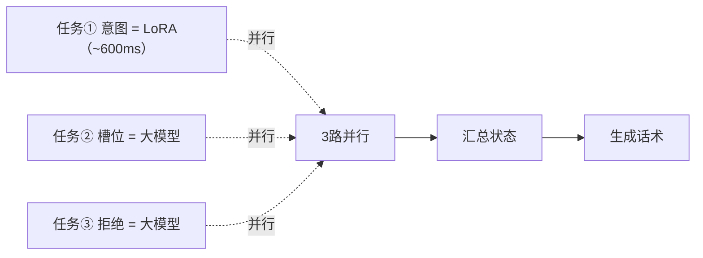
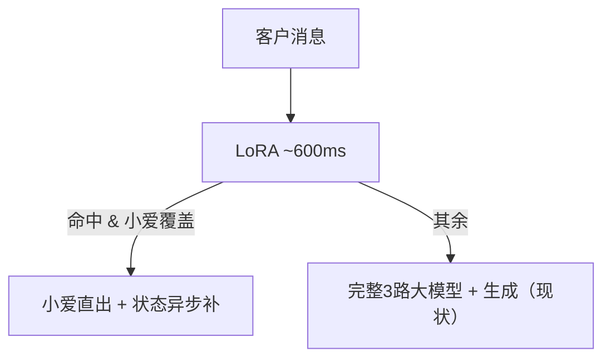
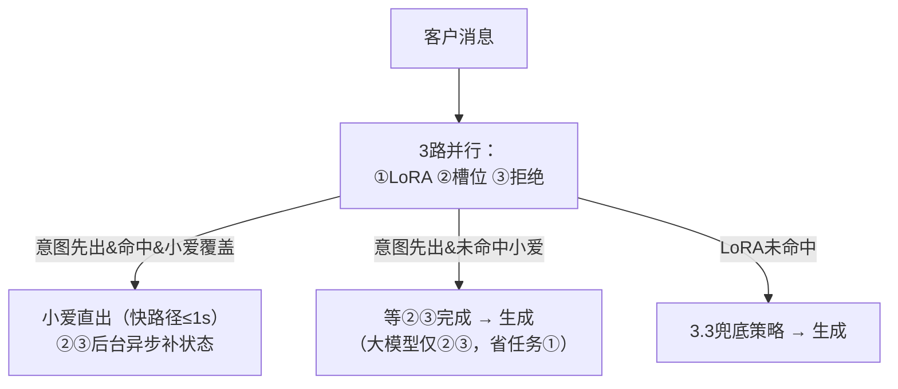

# 新旧小爱融合 · 架构设计方案（v0.4）

> 状态：待评审。
> 已确认事实：
> - **LoRA 即 3 路中的意图路（任务①）**，~600ms，只覆盖高频意图子集，仅输出意图分类；
> - 小爱助手纯话术生成，覆盖约 25% 语义点，系统侧维护完整状态；
> - 现状端到端 P95≈5-6s（3 路均为大模型调用），快路径期望 **≤1s**；
> - 全量双跑类方案（LoRA 与 3 路各自独立双跑）已排除。
> 未确认数值一律标【待确认】。

---

## 一、背景与认知修正

现有链路：任务①意图 / 任务②槽位 / 任务③拒绝，**3 路均为大模型并行**，汇总后生成话术，P95≈5-6s。

**本次认知修正**：意图路由 **LoRA 承担（它就是任务①）**。因此"3 路并行"变为：



大模型链路天然只剩 **②③ 两路**（意图不占大模型时延，除非需要兜底，见三-3）。这带来两个新机会、一个必须回答的问题：

| 机会/问题 | 说明 |
|---|---|
| 机会 1｜意图先出 | LoRA 600ms 即回，不必等②③ → 命中即可**先行分路** |
| 机会 2｜大模型路径缩短 | 大模型只并跑②③，省掉任务①的时延与成本 |
| 问题 1｜LoRA 未命中 | LoRA 只覆盖高频子集，未命中消息的意图如何兜底【待确认，见三-3】 |

---

## 二、目标与约束

| 项 | 目标 | 说明 |
|---|---|---|
| 快路径端到端（LoRA+小爱） | **P95 ≤ 1s** | 600ms + 小爱耗时【待确认】+ 校验；小爱需 ≤300-400ms 才可达标 |
| 大模型路径 | 优于现状（省任务①） | ②③并行 + 生成 |
| 成本 | 命中路径免大模型意图与生成 | 全量双跑排除 |
| 质量护栏 | 不降级（事实正确、已留资不索资、规则先行） | 小爱路径同样过确定性校验 |

---

## 三、通用设计

### 3.1 快路径：意图先出 → 命中小爱 → 直接返回

```
3路并行启动：
  任务① LoRA(600ms) ──先出──▶ 命中 & 小爱覆盖？──是──▶ 小爱直出回复
  任务② 槽位(大模型) ──后台继续──▶ 状态异步补齐─────────┘
  任务③ 拒绝(大模型) ──后台继续──▶
```

- 回复不等②③：小爱是纯话术生成，不依赖状态 → 回复先返回，槽位/拒绝异步跑完并记录（不阻塞展示）。
- 索资对策：非索资类本轮不索资、留待下轮；索资类正文先出、索资句由规则基于异步状态补发（小爱是否覆盖索资话术【待确认】）。

### 3.2 大模型路径：②③ 并行 + 生成

意图先出但**未命中**小爱时：等②③完成后，用 **LoRA 给定的意图 + 槽位 + 拒绝** 走话术生成。与现状比省掉任务①（大模型意图）的时延与成本。

### 3.3 LoRA 未命中 → 意图兜底（关键决策点）

| 选项 | 做法 | 时延 | 风险 |
|---|---|---|---|
| 兜底 a | LoRA 未命中时**增启大模型意图路**（额外第 4 路，延迟 600ms 启动） | 最差路径**长于现状** | 低（意图完整） |
| 兜底 b | 未命中即按 **UNKNOWN** 走现有降级（不索资 + 简化答疑/FALLBACK） | 最差路径 ≤ 现状 | 中（低频意图质量下降） |
| 兜底 c | 兜底 a + 限频：仅对"疑似强信号/索资触发"类未命中消息补大模型意图，其余走 UNKNOWN | 可控 | 中 |

> 需产品/算法定夺【待确认 1】。该决策影响所有方案的最差时延与质量下限。

### 3.4 快路径 1s 可行性约束

```
LoRA 600ms + 小爱 T_s + 校验 T_c ≤ 1000ms → T_s + T_c ≤ 400ms
```
备选收敛：LoRA 与小爱各自并行启动（小爱自带语义自识别可自行判定命中，不依赖 LoRA）→ 快路径 ≈ max(LoRA,小爱)+校验；是否可用视小爱能力【待确认】。

---

## 四、三个候选方案

### 方案 A：串行前置路由（最保守，意图路不动）

LoRA 仅作为**外部快速通道**：先串行跑 LoRA，命中&小爱覆盖 → 小爱直出；否则走**现有完整 3 路**（意图仍为大模型）。



- 优点：不改现有意图路，接入风险最小，可最快上线验证命中率。
- 缺点：LoRA 与 3 路**串行**（未命中时白等 600ms）；未做任何减路；意图大模型成本保留。

### 方案 B：并行内嵌（LoRA 即意图路，意图先出命中走小爱）——本次明确要求

LoRA 就是任务①，与②③**同步并行**：意图先出（600ms）且命中小爱 → **立即小爱直出**（不等②③，②③异步补状态）；意图先出未命中 → 等②③完成走大模型生成（省任务①）；LoRA 未命中 → 按 3.3 兜底策略处理。



- 优点：快路径时延最优（600ms 级即出）；大模型天然只跑②③；LoRA 本就是任务①，无额外调用开销。
- 缺点：未命中时②③可能白跑（成本浪费小，因为②③本来就要跑）；LoRA 未命中兜底策略是硬依赖；需把线上意图路从大模型切换为 LoRA。

### 方案 C：分级漏斗（工程终局：模板级 + 并行内嵌 + 路由表灰度）

在方案 B 的并行内嵌基础上叠加：0 级模板指纹直出；1/2/3 级为 B 的三态；路由矩阵（意图 × 小爱覆盖）配置化、可灰度可回退。

| 分级 | 判定 | 处理路径 |
|---|---|---|
| 0 | 模板指纹/系统卡片（规则） | 直出，0 模型调用 |
| 1 | 意图先出 & 小爱覆盖 | 小爱直出 + 状态异步补（B 快路径） |
| 2 | 意图先出 & 非小爱 | ②③完成 → 生成（B 大模型路径） |
| 3 | LoRA 未命中 | 3.3 兜底策略 |

- 优点：全量利用 LoRA 结果 + 路由可配置灰度；0 级承接开场白≈0 成本。
- 缺点：实现复杂度最高。

---

## 五、方案对比

| 维度 | A 串行前置 | B 并行内嵌 | C 分级漏斗 |
|---|---|---|---|
| 意图路 | 大模型（LoRA 前置） | **LoRA（即任务①）** | LoRA（+模板0级） |
| 大模型调用 | 全 3 路（未命中时） | 恒②③（+必要时兜底①） | 恒②③（+必要时兜底①） |
| 快路径时延 | ~1s（600ms+小爱+校验） | ~1s，600ms 级即出 | ~1s |
| 大模型路径时延 | = 现状（3路） | **短于现状（省任务①）** | 同 B |
| 最难防的风险 | 无（意图路不动） | LoRA 未命中兜底（3.3） | 同 B |
| 实现复杂度 | 低 | 中 | 高 |
| 灰度/回退 | 中 | 中 | 高 |
| 与现状差异 | 只加了快车道 | 意图路换 LoRA + 并行 | B + 模板 + 配置化 |

---

## 六、关键决策点（剩余待确认）

1. **LoRA 未命中的意图兜底策略**（3.3 的 a/b/c）【最高优先】：决定最差时延与低频意图质量。
2. **小爱单次回复耗时**：是否 ≤300-400ms，决定快路径 ≤1s 是否成立。
3. **②③两路 P50/P95 耗时**：量化"省任务①"收益，验证 B/C 大模型路径提速幅度——从 Langfuse/OTel 拉当前 Trace。
4. **任务①（大模型意图）现状耗时**：A vs B/C 的时延差距量化依据。
5. **小爱 25% 语义点对应流量占比**：估算整体收益面。
6. **小爱是否覆盖索资类话术**：影响 3.1 索资对策。
7. **是否可暂缓 LoRA 与大模型意图的并行兜底复杂度**：若可，一期用兜底 b（UNKNOWN 降级）最小化改动。

---

## 七、初步倾向

- **首选方案 C，一期从 B 形态落地**：B 是"LoRA 即意图路 + 并行内嵌"的最小完整形态，满足"意图先出、命中小爱即走小爱"；C 在 B 之上加模板级与路由表灰度，作为工程化演进。
- **方案 A 仅作为备选**：若团队不想动现有意图路（大模型），或 LoRA 上线初期置信度不足时，A 可用最快速度验证小爱命中率。
- **先决数据**：LoRA 未命中兜底策略（3.3）与小爱耗时（约束快路径 1s）；建议同步拉取 ②③ 与任务①的 Trace 耗时来量化 B/C 收益。