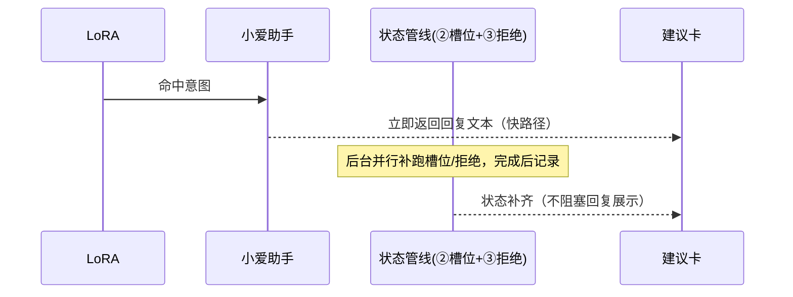
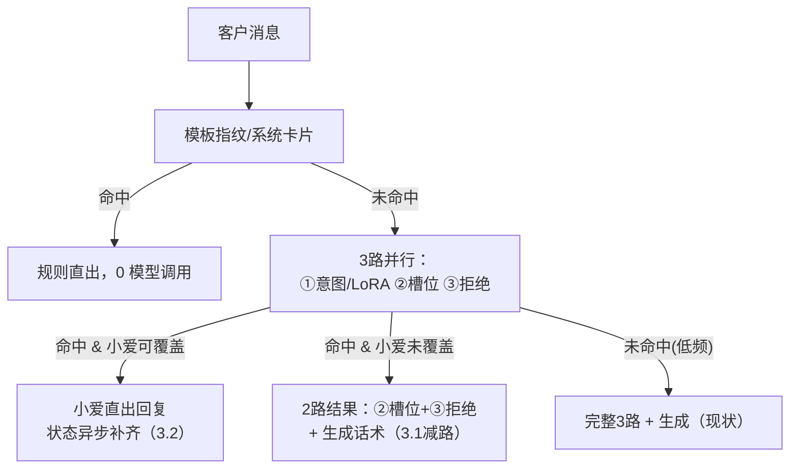
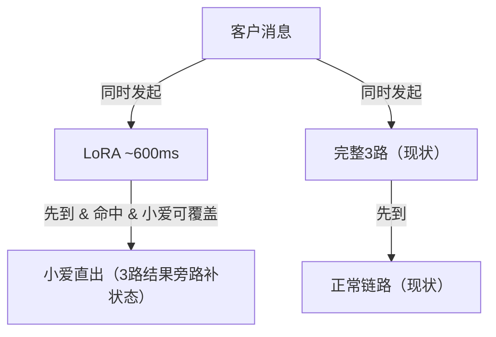
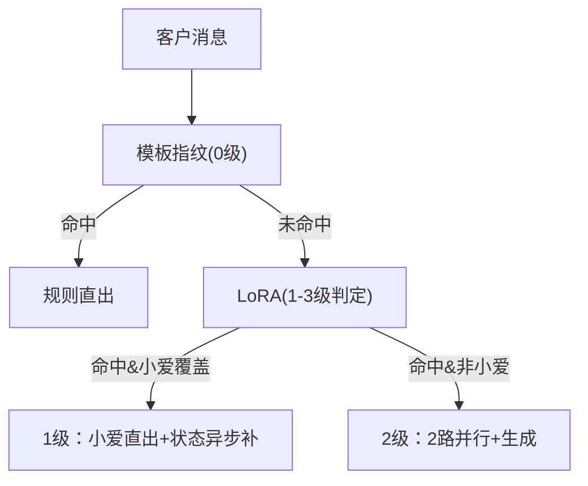

# 新旧小爱融合 · 架构设计方案（v0.2）

> 状态：待评审。
> 已确认事实：
> - **LoRA 即 3 路中的意图路（任务①）**，~600ms，只覆盖高频意图子集，仅输出意图分类；
> - 小爱助手纯话术生成，覆盖约 25% 语义点，系统侧维护完整状态；
> - 现状端到端 P95≈5-6s（3 路均为大模型调用），快路径期望 **≤1s**；
> - 全量双跑类方案（LoRA 与 3 路各自独立双跑）已排除。
> 未确认数值一律标【待确认】。

---

## 一、背景与问题

1. **现状时效瓶颈**：意图识别已由"一次大模型调用"拆为 **3 路并行**（任务①意图识别 / 任务②需求槽位抽取 / 任务③拒绝留资判定），并行汇总后再走话术生成，**端到端 P95≈5-6s，仍不达标**（原门槛 P95≤5s）。
2. **已有资产**：
   - **小爱助手**：轻量化语义模型，**纯话术生成**，覆盖部分话术，时效快；本身不依赖意图/槽位/拒绝状态（状态由系统侧维护）。
   - **LoRA 意图模型**：~600ms；**只覆盖高频意图子集**，未覆盖意图归未知；**仅输出意图分类**（无槽位、无拒绝判定）。
3. **本次目标**：以 LoRA 做意图分类前置，据此路由——小爱可覆盖的高频话术直接走小爱，其余回落大模型链路，并回答"是否需同时调用原有 3 路再取结果"。

### 现有链路（基准）


---

## 二、目标与约束

| 项 | 目标 | 说明 |
|---|---|---|
| 端到端时效 | 现状 P95≈5-6s → 目标【待确认】 | 命中 LoRA/小爱路径目标可至 ~1.5s 级；未命中路径至少不劣化 |
| 成本 | 【待确认】单建议模型成本预算 | 决定是否接受全量双跑（方案 B） |
| 质量护栏 | 不降级（事实正确、已留资不索资、规则先行） | 小爱/LoRA 路径同样过确定性校验 |

---

## 三、通用增量设计（三个方案共用）

以下两项是所有方案的公共底座，先定这两个机制：

### 3.1 减路优化：LoRA 命中 → 大模型只跑 ②③

任务①（意图识别）是大模型链路的第一个、通常也是最重要的调用（完整上下文 + 81 意图分类）。**只要 LoRA 命中**（给出可信意图），任务①即由 LoRA 交付：

```text
原：任务① || 任务② || 任务③   （3 路并行）
新：任务② || 任务③             （2 路并行，意图由 LoRA 给定）
```

- 收益：3 路降为 2 路，直接砍掉任务①的耗时与成本（任务①单独耗时【待确认】，若占 3 路总耗时的 50%+，此项收益显著）。
- 约束：LoRA 命中率越高收益越大；未命中仍走完整 3 路。

### 3.2 状态异步补齐：小爱回复快出，状态后台补

小爱是纯话术生成，回复不依赖状态 → **回复可以不等状态**：



- 收益：快路径端到端 ≈ LoRA(600ms)+小爱(【待确认】)+校验，**约 1.5s 级**。
- 风险与对策：本轮索资决策依赖状态。对策：①命中小爱的话术若属**非索资类**，本轮不索资、索资留给下轮；②若属**索资类**话术，小爱路径先出正文，索资句由规则基于异步补全状态在本轮内补发（延后毫秒级，可行则做）。具体需确认小爱是否覆盖索资话术（见五-3）。

---

## 四、三个候选方案

### 方案 A：串行级联路由（省成本优先）

**核心思路**：消息 → 模板指纹(0ms) → LoRA(600ms)，串行分三支，无并行双跑。



- **是否同时调 3 路？** 否。最多 2 路（LoRA 已交付任务①时）。
- 优点：命中路径成本最低、时延最优；实现简单无仲裁。
- 缺点：未命中路径（低频意图+低频话术）与现状一致，无提速；命中率决定总体收益。

### 方案 B：并行双通道取优（时效最稳，成本最高）

**核心思路**：每条消息**同时**发起 LoRA 与完整 3 路，谁先出可信结果谁生效。



- **是否同时调 3 路？** 是，全量双跑。
- 优点：所有消息端到端 ≥ 现状（取先到者），无串行惩罚；开关简单。
- 缺点：**成本 = LoRA + 3 路全量双跑**，在"LoRA 仅覆盖子集"的约束下白跑比例高，性价比最低；仅当"时效是唯一 KPI、成本不敏感"时成立。

### 方案 C：意图分级漏斗路由（推荐候选）

**核心思路**：按「模板 → LoRA命中×小爱覆盖 → LoRA命中×非小爱 → LoRA未命中」四级路由，每级选择 A 或 B 的路径；路由矩阵**配置化、可灰度**。

| 分级 | 判定 | 处理路径 | 期望 |
|---|---|---|---|
| 0 | 模板指纹/系统卡片（规则） | 直出，0 模型调用 | 开场白类 ≈0 成本 |
| 1 | LoRA 命中 & 小爱可覆盖 | 小爱直出 + 状态异步补（3.2） | 高频简单咨询 ~1.5s 级 |
| 2 | LoRA 命中 & 小爱未覆盖 | 2 路并行（②③）+ 生成（3.1 减路） | 大模型路径提速 |
| 3 | LoRA 未命中（低频/未知） | 完整 3 路 + 生成（现状） | 质量兜底 |



- **是否同时调 3 路？** 否。2 级最多并行 2 路（减路优化）；无全量双跑。
- 优点：把方案 A 的省钱支路（0/1 级）与减路提速（2 级）统一进一张路由表，兼顾时效/成本/质量，且按意图逐级灰度放开、坏例可回退。
- 缺点：实现复杂度最高（三套路径 + 路由表管理）；依赖"意图-小爱覆盖矩阵"的准确性（待确认 3）。

---

## 五、方案对比

| 维度 | A 串行级联 | B 并行双通道 | C 分级漏斗 |
|---|---|---|---|
| 最快路径时延 | ~1.5s 级（小爱） | ~1.5s 级（小爱） | ~1.5s 级（0/1级） |
| 最慢路径时延 | = 现状(3级未命中) | ≤ 现状（取先到） | = 现状(3级未命中) |
| LoRA 命中路径 | 2路并行（减路） | 3路并行（未减） | 2路并行（减路） |
| 模型成本 | 低 | **最高（全量双跑）** | 低 |
| 实现复杂度 | 低 | 低-中 | 高 |
| 灰度/回退 | 中 | 中 | **最高（配置化）** |
| 适用前提 | 命中率足够 | 时效唯一KPI、成本不敏感 | 有完整意图-小爱覆盖矩阵 |

---

## 六、关键决策点（剩余待确认）

1. **高频意图子集的流量占比**：LoRA 命中的意图累计覆盖多少比例的客户消息？（决定 1/2 级合计覆盖率）——可向算法团队要评测集/离线统计。
2. **3 路各自耗时**：任务①②③ 的 P50/P95 分别多少？（决定减路优化收益，任务①是否是大头）——从现有 Langfuse/OTel 拉当前 Trace。
3. **小爱助手能力**：单次回复耗时？是否覆盖**索资类**话术（影响 3.2 的索资对策）？覆盖话术清单是否有现成的意图关联表？
4. **快路径目标值**：LoRA+小爱路径的端到端 P95 期望控制在多少？（1.5s 是估算，需确认是否够）
5. **成本 vs 时效优先级**：两者冲突时保哪个？（直接否决/限定方案 B）

---

## 七、初步倾向

在已有约束下（LoRA 只覆盖高频子集、只有意图、小爱纯话术）：
- **首选方案 C**：0/1 级承接高频简单消息（当前业务大头），2 级用减路优化照顾 LoRA 命中但需状态的场景，3 级兜底低频。命中即可灰度和回退。
- **方案 B 基本排除**：LoRA 覆盖率受限，全量双跑成本浪费远大于收益。
- **方案 A 可作为 C 的简化起点**：先期只实现 0/1/3 三级（暂缓 2 级减路），用最小成本验证命中率与收益，再叠加 2 级。

若待确认项 1/2 显示命中率与任务①耗时占比都很高，C 的收益会显著放大，建议尽快拉取这两项数据来定案。